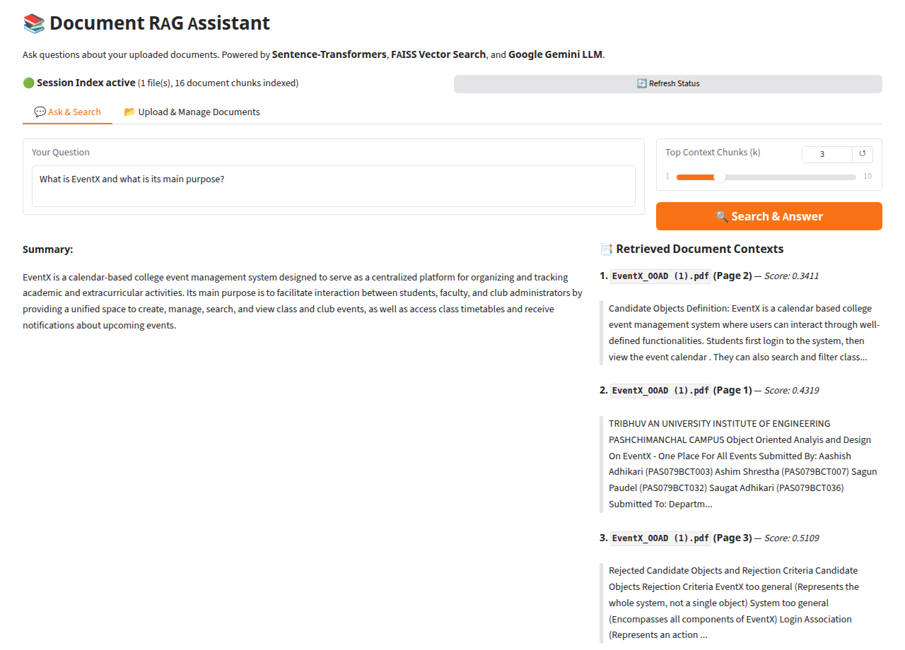
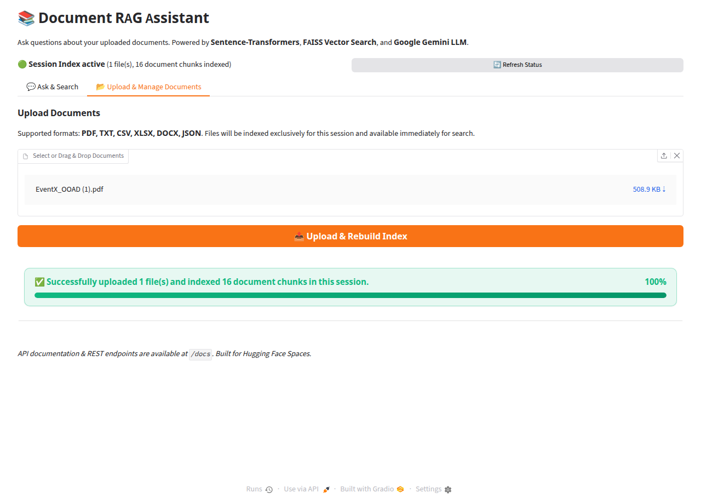

# Document RAG Assistant

A retrieval-augmented generation system that indexes multi-format documents into a FAISS vector index and synthesizes answers with source citations using Google Gemini.

[](https://www.python.org/)
[](https://fastapi.tiangolo.com/)
[](https://gradio.app/)
[](https://github.com/facebookresearch/faiss)
[](https://ai.google.dev/)
[](https://huggingface.co/spaces/saugatadk101/document-rag-assistant)
[](LICENSE)

---

## Overview

Finding precise answers across fragmented local files (PDFs, spreadsheets, text documents) typically requires manual reading or yields inaccurate LLM responses when models hallucinate without source context. **Document RAG Assistant** parses uploaded files, chunks and embeds their contents into an in-memory vector index, retrieves relevant passages via cosine similarity, and streams grounded answers accompanied by page-level citations. The system is designed for researchers, students, and engineers who need local or hosted document question-answering with verifiable source attribution.

---

## Features

- **Multi-Format Document Ingestion**: Ingests `.pdf`, `.txt`, `.csv`, `.docx`, `.xlsx`, and `.json` documents using LangChain document loaders.
- **Chunking & Shared Embeddings**: Splits text into 1,000-character segments (200-character overlap) and computes dense vector representations with `sentence-transformers/all-MiniLM-L6-v2` via an in-memory singleton.
- **Cosine Similarity Vector Search**: Indexes normalized embeddings with FAISS `IndexFlatIP` to retrieve the top-$k$ most relevant context chunks.
- **Session-Isolated Context**: Scopes uploaded documents and FAISS indices to individual user sessions in Gradio, preventing cross-session data leakage.
- **Grounded Answer Synthesis**: Queries Google Gemini (`gemini-3.1-flash-lite`) using direct HTTP header authentication (`x-goog-api-key`) and structured prompts.
- **Source Attribution**: Returns source filenames, page numbers, and similarity distances for every generated response.
- **Dual Interface**: Offers an interactive Gradio web UI and a FastAPI REST API (`/upload`, `/query`, `/health`).

---

## Tech Stack

| Layer | Technology |
|---|---|
| **Language** | Python 3.10+ |
| **LLM Inference** | Google Gemini API (`gemini-3.1-flash-lite`) via `requests` |
| **Embeddings** | `sentence-transformers` (`all-MiniLM-L6-v2`, 384 dimensions) |
| **Vector Store** | FAISS (`faiss-cpu`, `IndexFlatIP` with L2-normalized vectors) |
| **Document Processing** | LangChain Community loaders (`PyPDFLoader`, `Docx2txtLoader`, `UnstructuredExcelLoader`, `CSVLoader`, `TextLoader`, `JSONLoader`) |
| **Text Splitting** | `langchain_text_splitters.RecursiveCharacterTextSplitter` |
| **Web Interface** | Gradio Blocks (`gradio>=6.0.0`) |
| **REST API** | FastAPI + Uvicorn |
| **Deployment Target** | Hugging Face Spaces (Free Tier CPU / ZeroGPU) & Local Environments |

---

## Demo & Screenshots

- **Live Demo**: [Hugging Face Spaces](https://huggingface.co/spaces/saugatadk101/document-rag-assistant)


*Figure 1: Query input, Gemini-generated answer, and ranked citations with similarity scores.*


*Figure 2: Real-time progress bar during document loading, chunking, and embedding generation.*

---

## Project Structure

```text
RAG/
├── app.py              # Main Gradio application launcher
├── requirements.txt    # Project dependencies
├── pyproject.toml      # Build metadata and packaging config
├── Dockerfile          # Container specification for standalone deployments
├── data/               # Default document storage directory
│   └── uploads/        # Staging folder for uploaded user documents
├── src/
│   ├── api.py          # FastAPI application routes (/query, /upload, /health)
│   ├── dataloader.py   # Multi-format document parser and file loaders
│   ├── embedding.py    # Chunking pipeline and singleton SentenceTransformer model
│   ├── paths.py        # Path resolution helpers for local and container environments
│   ├── search.py       # RAGSearch class managing FAISS retrieval and Gemini generation
│   ├── ui.py           # Gradio Blocks layout, session state, and event handlers
│   └── vectorstore.py  # FaissVectorStore wrapper for L2 normalization, search, and persistence
└── tests/              # Test suites and validation scripts [ADD: test directory path if customized]
```

---

## Getting Started

### Prerequisites

- **Python**: Version `3.10` or higher
- **Package Manager**: `pip` or `uv`
- **Gemini API Key**: A Google AI Studio API key ([ai.google.dev](https://ai.google.dev/))

### Installation

1. **Clone the repository**:
   ```bash
   git clone https://github.com/saugatadk/RAG.git
   cd RAG
   ```

2. **Create and activate a virtual environment**:
   ```bash
   python3 -m venv .venv
   source .venv/bin/activate
   ```

3. **Install dependencies**:
   ```bash
   pip install -r requirements.txt
   ```

### Configuration

Create a `.env` file in the project root:

```bash
cat << 'EOF' > .env
GEMINI_API_KEY=your_gemini_api_key_here
GEMINI_MODEL=gemini-3.1-flash-lite
EOF
```

### Running Locally

- **Option A: Run the Gradio Web Interface**:
  ```bash
  python app.py
  ```
  Open `http://127.0.0.1:7860` in your web browser.

- **Option B: Run the FastAPI Server (with embedded Gradio interface)**:
  ```bash
  uvicorn src.api:app --host 0.0.0.0 --port 7860 --reload
  ```
  Interactive Swagger API documentation will be available at `http://127.0.0.1:7860/docs`.

### Running Tests

Validate the retrieval and generation pipeline:

```bash
python -m src.search
```

---

## Usage Examples

### 1. Web Interface Workflow

1. Navigate to the **"Upload & Manage Documents"** tab.
2. Select one or more `.pdf`, `.docx`, `.csv`, `.xlsx`, or `.txt` files and click **"Upload & Index Documents"**.
3. Watch the progress bar confirm chunking and embedding completion.
4. Switch to the **"Ask Questions"** tab, type a question, and click **"Search & Answer"**.
5. Inspect the synthesized answer and review the retrieved context citations listed below the response.

### 2. REST API Workflow

**Index files via `curl`**:
```bash
curl -X POST "http://127.0.0.1:7860/upload?rebuild_index=true" \
  -H "accept: application/json" \
  -H "Content-Type: multipart/form-data" \
  -F "files=@data/pdf/sample.pdf"
```

**Query the indexed documents**:
```bash
curl -X POST "http://127.0.0.1:7860/query" \
  -H "accept: application/json" \
  -H "Content-Type: application/json" \
  -d '{
    "query": "What are the primary project deliverables?",
    "top_k": 3
  }'
```

**Example JSON Response**:
```json
{
  "query": "What are the primary project deliverables?",
  "summary": "The primary project deliverables include the backend API, the FAISS search pipeline, and the Gradio web dashboard.",
  "results": [
    {
      "text": "Deliverables: 1. Core API service... 2. Search index...",
      "source": "sample.pdf",
      "page": 2,
      "distance": 0.2841
    }
  ]
}
```

---

## Project Role & Contributions

This is a **solo project** engineered from scratch by **Saugata Adhikari**:

- Designed and implemented the multi-format ingestion layer ([src/dataloader.py](src/dataloader.py)) supporting 6 file types.
- Integrated `sentence-transformers` with FAISS (`IndexFlatIP`) using L2 normalization to enable cosine similarity search ([src/vectorstore.py](src/vectorstore.py)).
- Engineered the session-isolated indexing logic in Gradio ([src/ui.py](src/ui.py)), guaranteeing uploaded documents remain bounded to user sessions.
- Integrated Google Gemini API (`gemini-3.1-flash-lite`) via direct HTTP requests with header-based authorization (`x-goog-api-key`) and sanitized exception handling ([src/search.py](src/search.py)).
- Built the FastAPI service ([src/api.py](src/api.py)) and Docker configuration for Hugging Face Spaces deployment.

---

## Challenges & Learnings

- **FAISS Cosine Distance Calibration**: Standard FAISS `IndexFlatL2` calculates squared Euclidean distance, which distorted similarity scoring on variable-length text chunks. Resolved this by switching to `IndexFlatIP` and applying `faiss.normalize_L2` to both chunk and query embeddings to achieve cosine similarity within $[-1, 1]$.
- **Cross-Session Vector Isolation**: Default server-level global vector indices leaked documents between concurrent browser tabs. Refactored the architecture to instantiate and maintain `FaissVectorStore` instances inside Gradio's `gr.State()`, ensuring session independence.
- **Credential Leak Prevention**: Standard `requests.raise_for_status()` embedded URL query parameters (including API keys) into exception strings during HTTP 429 rate-limiting events. Replaced URL key parameters with the `x-goog-api-key` header and implemented sanitized custom status code handling.
- **Embedding Pipeline Memory Management**: Reloading the 384-dimensional SentenceTransformer model per upload caused memory spikes and latency. Implemented an in-memory singleton pattern (`get_shared_embedding_model`) to keep weights warm across sessions without memory duplication.

---

## Future Improvements

- [ ] Add query semantic caching via a secondary FAISS index to serve repeated questions in sub-10ms with zero token cost.
- [ ] Implement document access control (RBAC) metadata tagging to restrict chunk retrieval based on user roles.
- [ ] Add input guardrails to detect and block prompt injection patterns prior to vector lookup.
- [ ] Implement dynamic query complexity routing between Gemini Flash-Lite and Gemini Pro.
- [ ] Add an automated evaluation test suite calculating retrieval faithfulness and context precision before deployment.

---

## Team & Acknowledgements

- **Developer**: Saugata Adhikari ([@saugatadk](https://github.com/saugatadk))
- **Affiliation**: Independent Portfolio Project
- **Acknowledgements**: [ADD: Any mentor, course reference, or colleague you wish to acknowledge, e.g. open-source communities, Hugging Face, Google AI Studio]

---

## License

This project is licensed under the **MIT License**.