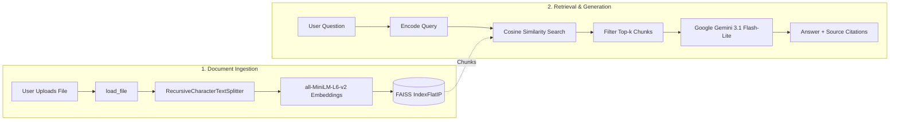

# 📚 Document RAG Assistant

[](https://www.python.org/)
[](https://gradio.app/)
[](https://fastapi.tiangolo.com/)
[](https://github.com/facebookresearch/faiss)
[](https://ai.google.dev/)
[](https://huggingface.co/spaces)

A high-performance Retrieval-Augmented Generation (RAG) assistant designed for fast document ingestion, semantic search, and AI-powered context synthesis. Powered by **Google Gemini 3.1 Flash-Lite**, **Sentence-Transformers**, **FAISS Vector Search**, **FastAPI**, and **Gradio**.

Built for zero-cost deployment on **Hugging Face Spaces** (Free Tier: 2 vCPU · 16 GB RAM) and local environments.

---

## 🌟 Key Features

- **Sub-Second Incremental Ingestion:** Ingests and indexes documents in under `0.6` seconds using an $O(1)$ incremental pipeline without re-processing previously uploaded files.
- **Strict Session Isolation:** Queries and citations are grounded exclusively on documents uploaded in the active session, eliminating cross-session leaks and outdated document bleed.
- **Multi-Format Document Support:** Extracts and chunks text seamlessly from `.pdf`, `.txt`, `.csv`, `.xlsx`, `.docx`, and `.json`.
- **High-Precision Semantic Retrieval:** Normalized inner-product cosine similarity powered by `all-MiniLM-L6-v2` dense embeddings.
- **Dual Interface:**
  - **Interactive Web App:** User-friendly Gradio interface with live upload progress tracking, streaming indicators, and document citations with page numbers.
  - **REST API:** Fully featured FastAPI endpoints (`/query`, `/upload`, `/health`) with interactive OpenAPI / Swagger documentation.
- **Zero-Cost Deployment:** Native compatibility with Hugging Face Spaces Free Tier and ZeroGPU support via `@spaces.GPU`.

---

## 🏗️ System Architecture



---

## 🚀 Quick Start (Local Development)

### Prerequisites

- Python 3.10+
- Google Gemini API Key ([Get a free key here](https://aistudio.google.com/app/apikey))

### 1. Clone the Repository

```bash
git clone https://github.com/saugatadk/RAG.git
cd RAG
```

### 2. Set Up Virtual Environment

```bash
python3 -m venv .venv
source .venv/bin/activate
pip install -r requirements.txt
```

### 3. Configure Environment Variables

Create a `.env` file in the project root:

```env
GEMINI_API_KEY=your_gemini_api_key_here
GEMINI_MODEL=gemini-3.1-flash-lite
```

*(Optional fallback: `OPENROUTER_API_KEY=your_openrouter_key`)*

### 4. Run the Application

#### Option A: Gradio Web UI (Recommended)
```bash
python app.py
```
Open **[http://localhost:7860](http://localhost:7860)** in your browser.

#### Option B: FastAPI REST Server
```bash
uvicorn src.api:app --host 0.0.0.0 --port 7860 --reload
```
Access the interactive Swagger API documentation at **[http://localhost:7860/docs](http://localhost:7860/docs)**.

#### Option C: Docker Container
```bash
docker build -t document-rag .
docker run -p 7860:7860 --env-file .env document-rag
```

---

## ☁️ Deployment to Hugging Face Spaces

This repository is pre-configured for one-click deployment to Hugging Face Spaces.

1. Create a new Space at **[huggingface.co/new-space](https://huggingface.co/new-space)**:
   - **Space SDK:** `Gradio`
   - **Hardware Tier:** `Free` (2 vCPU · 16 GB RAM)
2. Add your API key in **Settings > Variables and secrets**:
   - Secret Name: `GEMINI_API_KEY`
   - Secret Value: `your-gemini-api-key`
3. Push to Hugging Face:

```bash
git remote add space https://huggingface.co/spaces/<YOUR_HF_USERNAME>/<YOUR_SPACE_NAME>
git push space main
```

---

## 📡 REST API Reference

| Method | Endpoint | Description |
|---|---|---|
| `GET` | `/` | Web Chat & Document Upload Interface |
| `GET` | `/docs` | Interactive OpenAPI / Swagger UI |
| `GET` | `/health` | Service health status check |
| `POST` | `/query` | Query RAG pipeline (`{"query": "...", "top_k": 3}`) |
| `POST` | `/upload` | Upload and index new documents |

### Example Query Request

```bash
curl -X POST "http://localhost:7860/query" \
     -H "Content-Type: application/json" \
     -d '{"query": "What are the core methodologies in the study guide?", "top_k": 3}'
```

---

## 📂 Project Structure

```
├── app.py                  # Gradio application entrypoint
├── Dockerfile              # Container definition for containerized deployment
├── requirements.txt        # Production dependencies
├── pyproject.toml          # Project configuration & packaging
├── README.md               # Project documentation
├── src/
│   ├── dataloader.py       # Multi-format document loaders (.pdf, .txt, .csv, .docx, .json)
│   ├── embedding.py        # Embedding pipeline & shared model singleton
│   ├── vectorstore.py      # FAISS vector store with incremental indexing
│   ├── search.py           # Context retrieval & Gemini LLM synthesis
│   ├── ui.py               # Gradio UI components with session state & live progress
│   ├── api.py              # FastAPI REST endpoints
│   └── paths.py            # Environment-aware path resolution
└── data/
    ├── uploads/            # Upload staging directory
    └── faiss_store/        # Local persistent FAISS vector indices
```

---

## 📄 License

This project is licensed under the MIT License.
